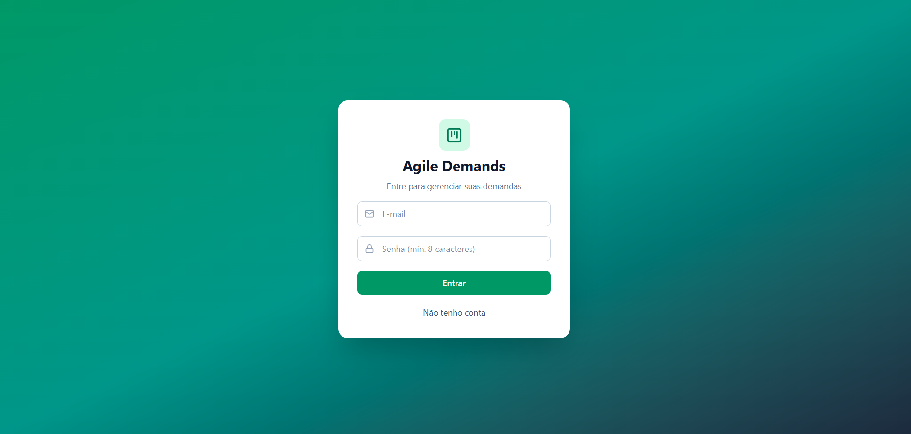
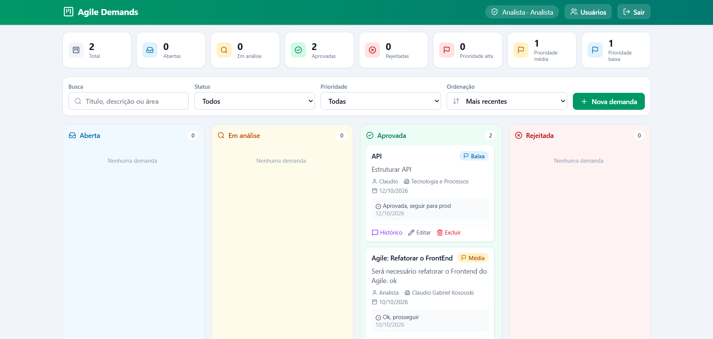
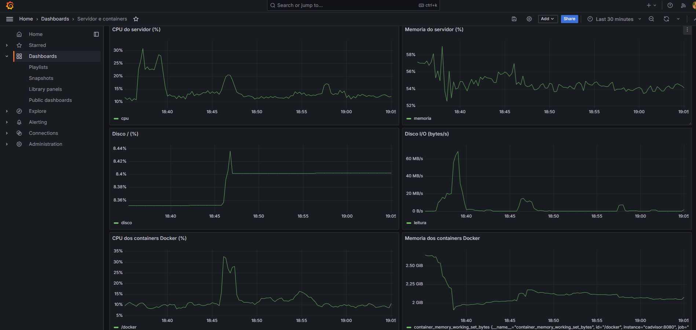
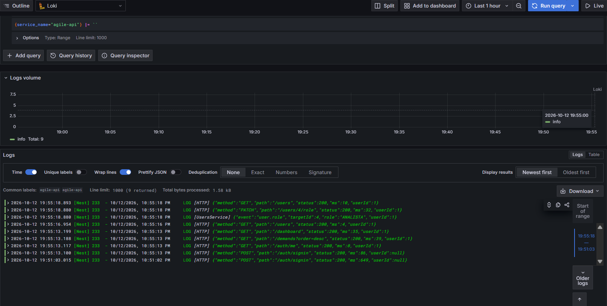
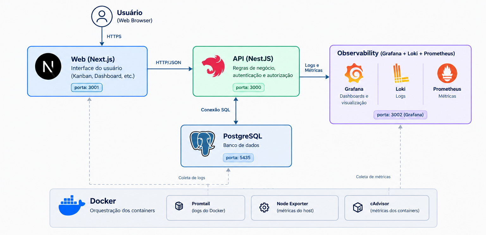

# Agile Demand

Sistema web para centralizar solicitações internas, acompanhar seu fluxo de análise e consultar o andamento/status das solicitações. Este projeto foi desenvolvido para o desafio técnico de Assessor de Desenvolvimento de Sistemas na Sicredi Conexão.

## Como executar

O caminho recomendado e mais prático é usar **Docker Compose** para subir toda a aplicação (PostgreSQL, API, Front-end e Observabilidade). 

### Pré-requisitos

- Git
- Docker Desktop iniciado, com Docker Compose.
- Node.js 22 ou superior e npm (necessário apenas se optar por rodar o front-end fora do Docker)

Os comandos abaixo usam **PowerShell** e partem da raiz do repositório, onde está `docker-compose.yml`.

---

### Opção 1: Subir com o Docker Compose

```powershell

docker compose up -d --build
docker compose ps

```

Esse comando inicia as imagens da API (`backend/Dockerfile`) e do Front-end (`frontend/Dockerfile`) e inicia todos os serviços integrados:
- O **PostgreSQL** é iniciado e realiza health check.
- A **API** aguarda o banco ficar pronto, executa automaticamente as migrations (`prisma migrate deploy`) e o seed de dados padrão, iniciando na porta `3000`.
- O **Front-end** compila e serve a aplicação Next.js na porta `3001`.
- A stack de **observabilidade** (Loki, Promtail, Prometheus, Node Exporter, cAdvisor e Grafana) sobe coletando métricas e logs estruturados.

### Opção separada

1. **Subir banco, API e observabilidade:**
   ```powershell
   docker compose up -d --build postgres api grafana prometheus loki promtail
   ```

Abra [http://localhost:3001](http://localhost:3001). O arquivo `frontend/.env.local` define `NEXT_PUBLIC_API_URL=http://localhost:3000`.

### Acessos locais

| Serviço | Endereço | Acesso de desenvolvimento |
|---|---|---|
| Front-end | [http://localhost:3001](http://localhost:3001) | Crie uma conta pela tela de cadastro |
| API | [http://localhost:3000](http://localhost:3000) | REST; requer autenticação nas rotas protegidas |
| Swagger (OpenAPI) | [http://localhost:3000/api/docs](http://localhost:3000/api/docs) | Documentação interativa e teste de todos os endpoints |
| PostgreSQL | `localhost:5435` | Banco `agile`, usuário `postgres`, senha local `postgres` |
| Grafana | [http://localhost:3002](http://localhost:3002) | `admin` / `admin` |

O seed cria o user analista para primeiro acesso admin com email `analista@agile.com` e com senha `Analista@123` por padrão. Contas criadas pela tela de cadastro começam com o papel `SOLICITANTE`.

### Comandos úteis

Execute-os na raiz do projeto:

```powershell
docker compose ps                       # estado dos serviços
docker compose logs -f api              # logs da API
docker compose logs -f postgres         # logs do banco
docker compose restart api              # reinicia a API
docker compose up -d --build api        # reconstrói e inicia apenas a API
docker compose down                     # para os serviços; mantém os volumes e dados
```

No primeiro terminal, na raiz:

```powershell
docker compose up -d postgres
```

No segundo terminal:

```powershell
 cd backend
Copy-Item .env.example .env          # faça isso apenas na primeira execução
npm ci
npx prisma migrate deploy
npm run db:seed
npm run start:dev
```

No terceiro terminal, inicie o front-end conforme a etapa anterior. O `.env` do back-end deve usar a URL de banco para acesso pelo host (o exemplo fornecido aponta para `localhost:5435`).

## Interface e Telas do Sistema

Visão geral da experiência visual do **Agile Demand**, construída em Next.js com Tailwind CSS:

### 1. Tela de Login e Cadastro
Interface limpa e responsiva para autenticação por e-mail e senha, permitindo também o cadastro público de novos usuários solicitantes.

[](docs/img/Login.png)

### 2. Apresentação e Dashboard (Kanban e Indicadores)
Visão principal do sistema contendo os cards totalizadores em tempo real, filtros dinâmicos de busca e o quadro Kanban com as colunas de fluxo de status (`Aberta`, `Em análise`, `Aprovada` e `Rejeitada`).

[](docs/img/Dashboard.png)

---

### 3. Grafana para visualização de métricas do sistema.


### 4. Logs via Loki
Visualização dos logs estruturados do sistema via Loki, facilitando a análise de eventos e erros.



## Funcionalidades implementadas

- Cadastro e autenticação de usuários, com senha armazenada em hash e autenticação JWT.
- Papéis `SOLICITANTE` e `ANALISTA`; o seed cria o analista inicial e a gestão de papéis é restrita a analistas.
- Cadastro, consulta, edição e exclusão de demandas com título, descrição, solicitante, área, prioridade, status e datas.
- Busca textual, filtros por status e prioridade e ordenação por data.
- Solicitantes consultam as próprias demandas; analistas podem consultar todas. Solicitantes só podem editar ou excluir demandas próprias ainda abertas.
- Decisão de aprovação/rejeição por analista, com comentário e data da decisão.
- Kanban, histórico e comentários das demandas e dashboard com totais por status e distribuição por prioridade.
- PostgreSQL com migrations Prisma versionadas.
- Logs estruturados e stack local de observabilidade com Grafana, Loki, Prometheus, Promtail, Node Exporter e cAdvisor.

## Testes e qualidade

Os testes automatizados existentes estão no back-end e usam Vitest. Os comandos partem da pasta indicada:

```powershell
Set-Location .\backend
npm ci
npm run lint
npm test
```

Para validar o front-end:

```powershell
Set-Location ..\frontend
npm ci
npm run lint
npm run build
```

O workflow de CI está em [`.github/workflows/ci.yml`](.github/workflows/ci.yml). Ele instala dependências, executa lint e testes disponíveis e integra a análise SonarCloud.

## Arquitetura e decisões técnicas

O sistema é um **monólito modular dividido em front-end, API e banco de dados**: Next.js apresenta a interface, NestJS concentra regras e endpoints da API REST, Prisma faz o acesso ao PostgreSQL. Os módulos da API separam autenticação, usuários, demandas, dashboard e persistência. A stack de observabilidade é auxiliar e executada localmente via Compose.

[](docs/img/Arquitetura.png)

- [Abrir o diagrama da arquitetura](docs/img/Arquitetura.png)
- [Detalhes da arquitetura](docs/ARQUITETURA.md)
- [ADRs — decisões arquiteturais e alternativas consideradas](docs/ADRs/ADRs_Agile_Demand.md)

## Considerações arquiteturais do desafio

As respostas abaixo apresentam  evoluções possíveis para o sistema.

### Evolução, riscos e crescimento

**Mudanças para suportar crescimento:** manter inicialmente o monólito modular e validar o desempenho e os gargalos antes de separar serviços. Para maior carga, adicionar paginação, rate-limiting e caching nas consultas, revisar índices e planos de execução, configurar pool de conexões e escalar réplicas da API atrás de um Load Balancer. 

**Evolução da Infraestrutura em Nuvem (Kubernetes via Terraform na AWS & API Gateway):**
- **Orquestração com Kubernetes (EKS):** Provisionamento de toda a infraestrutura como código (IaC) utilizando **Terraform** modularizado (VPC com subnets públicas/privadas, cluster EKS, Node Groups gerenciados com Auto Scaling e banco de dados gerenciado AWS RDS PostgreSQL / Aurora Multi-AZ).
- **Camada de Borda e API Gateway:**
 - **AWS API Gateway:** Recomendado se a estratégia for 100% na AWS. Totalmente serverless, integração nativa com AWS WAF (Web Application Firewall), autenticação e rate limiting integrados e baixo custo operacional de infraestrutura.
 - **Kong Gateway (ou Ingress Controller no K8s):** Alternativa superior, permitindo executar a mesma camada de gateway tanto em clusters locais/on-premise quanto em múltiplos provedores de nuvem, com plugins de autenticação JWT, transformação de payloads e observabilidade (Prometheus/OpenTelemetry).
 - **Esteira e GitOps:** Deploy automatizado no cluster Kubernetes utilizando **Helm** para entrega contínua declarativa e auditável.

**Gestão Segura de Credenciais (Secrets Management):**
- **Ambiente local de avaliação:** Mantemos `.env.example` com valores pré-configurados e defaults no `docker-compose.yml` (`${JWT_SECRET_KEY:-...}`) para que seja possível executar a aplicação sem problemas para a avaliação. O `.env` real é protegido via `.gitignore`.
- **Ambiente Corporativo / Produção:**
  - Adoção de um cofre de credenciais corporativo como **HashiCorp Vault** ou **AWS Secrets Manager** / **AWS Systems Manager Parameter Store**.
  - No Kubernetes, integração via **External Secrets Operator (ESO)** ou **Secrets Store CSI Driver**, sincronizando credenciais diretamente para o pod em tempo de execução via variáveis de ambiente em memória ou volumes temporários, com suporte a rotação automática de chaves criptográficas.

**Principais riscos técnicos:** PostgreSQL e API são pontos únicos de falha no ambiente atual; não há alta disponibilidade nem rotina automatizada de backup/restore. As credenciais padrão são inseguras fora do desenvolvimento. Não há integração corporativa assíncrona implementada, nem paginação das listagens. Métricas de containers em Docker Desktop podem representar a VM de containers e não detalhar cada container.

**Escalabilidade, disponibilidade e manutenibilidade:** em uma implantação real, usar configuração e credenciais externas ao código, health checks, balanceamento e réplicas da API (Kubernetes seria uma alternativa para escalar e garantir a alta disponibilidade); definir backups testados e plano de recuperação do banco; criar alertas e acompanhar métricas, logs e traces, automatizar testes e migrations no pipeline, documentações e ADRs atualizados. Essas medidas reduzem riscos, mas não eliminam a necessidade de monitoramento contínuo e ajustes conforme a carga e o crescimento do sistema.

**Segurança das Rotas e Exigência do JWT:**
A API possui dois guards globais (`AuthGuard` e `RolesGuard`) protegem automaticamente todas as rotas registradas. O cabeçalho `Authorization: Bearer <token>` é obrigatório em todas as chamadas de negócio. As únicas rotas públicas são `/auth/signup` e `/auth/signin` (marcadas explicitamente com o decorator `@Public()`). Adicionalmente, as operações de decisão (`PATCH /demands/:id/decision`) e gestão de usuários (`/users`) exigem papel `ANALISTA`.

### Integração com Sistemas Externos

#### 1. Como realizaria a integração?

Como primeira evolução, implementaria notificações por e-mail utilizando SMTP ou um serviço corporativo de envio de mensagens. O solicitante poderia receber a confirmação da aprovação, enquanto equipes responsáveis seriam notificadas conforme as regras de negócio.

Para integrações com sistemas corporativos, como, por exemplo, SalesForce ou plataformas internas, utilizaria APIs HTTP/REST, conforme os contratos e mecanismos de autenticação disponibilizados pelo sistema de destino.

#### 2. Quais padrões ou tecnologias utilizaria?

A solução poderia evoluir de forma incremental:

- **SMTP:** envio de notificações por e-mail após a aprovação ou rejeição.
- **API REST:** comunicação com sistemas corporativos que disponibilizem endpoints para receber solicitações aprovadas.
- **Fila de mensagens:** RabbitMQ ou Kafka para desacoplar a aplicação do processamento externo, caso o volume e os requisitos operacionais justifiquem essa infraestrutura.
- **Worker de integração:** processo responsável por consumir eventos, executar as chamadas externas e registrar seus resultados.

O desenho inicial manteria o backend NestJS como responsável pelas regras de negócio. Os componentes de mensageria e integração seriam adicionados conforme a necessidade, sem complexidade desnecessária.

#### 3. Como trataria falhas de comunicação?

A falha de um sistema externo não deveria desfazer uma aprovação já registrada no Agile Demand.

Para isso, adotaria:

- Timeouts para limitar o tempo de espera por respostas.
- Retentativas com intervalos progressivos e limite de tentativas.
- Controle de falhas persistentes, com possibilidade de encaminhamento para uma fila de mensagens não processadas, quando houver um broker (RabbitMQ ou Kafka).
- Identificadores de operação e mecanismos de idempotência para reduzir o risco de processamento duplicado.
- Reprocessamento controlado das operações que falharem.

No caso de e-mails, falhas temporárias de envio seriam registradas e poderiam gerar novas tentativas, sem impedir que o usuário consulte a situação da demanda.

#### 4. Como garantiria a rastreabilidade das operações?

Cada evento de integração teria um identificador único de correlação, associado à demanda de origem.

Seriam registrados o identificador da demanda, o tipo de evento, os horários de processamento, o destino, o número de tentativas e o resultado da operação. Os logs estruturados poderiam ser consultados pela stack de observabilidade já presente no projeto, utilizando Loki e Grafana.

Quando aplicável, manteria também um histórico persistente do processamento, com estados como `PENDENTE`, `PROCESSANDO`, `CONCLUIDO` e `FALHA`, além de informações que permitam identificar e reprocessar operações com problemas.

Tokens, senhas e outros dados sensíveis não seriam registrados nos logs por conta de questões de segurança e privacidade (LGPD).

#### 5. Como evitaria impactos na experiência do usuário?

A aprovação seria confirmada após a conclusão da transação local. A comunicação externa aconteceria em segundo plano, permitindo que o usuário continuasse utilizando o sistema mesmo quando o destino estivesse indisponível.

A interface poderia apresentar separadamente o estado da decisão e o estado da integração. Por exemplo, uma demanda poderia estar `APROVADA` e, simultaneamente, com a integração `PENDENTE` ou `FALHA`.

Dessa forma, a indisponibilidade externa não bloquearia o fluxo principal. A operação permaneceria rastreável e poderia ser reprocessada sem exigir que o usuário aprovasse a demanda novamente.

#### Escopo da implementação atual

O Agile Demand já possui o fluxo de aprovação e a stack local de observabilidade. O envio de e-mails, a comunicação com sistemas corporativos externos e a mensageria são propostas de evolução e não fazem parte das funcionalidades implementadas nesta versão.

## Premissas e limitações

- O objetivo é demonstrar uma solução funcional e decisões técnicas no escopo e prazo do desafio.
- A execução documentada é local. O front-end, API, PostgreSQL e observabilidade são definidos no Compose.
- O papel inicial de analista é criado pelo seed. Os dados padrão de acesso e a senha do PostgreSQL são conveniências locais e devem ser substituídos fora desse cenário.
- Não há envio de notificações nem comunicação com sistemas corporativos externos implementados.
- O projeto ainda não implementa alta disponibilidade, backup automatizado, alertas operacionais, broker/outbox, paginação ou estratégia de deploy em produção.
- Podman é uma alternativa não validada; o socket usado pelo Promtail pode exigir configuração específica.
- No Docker Desktop para Windows, métricas de host podem refletir a máquina virtual do Docker. A granularidade por container depende do ambiente e da coleta do cAdvisor configurado.
